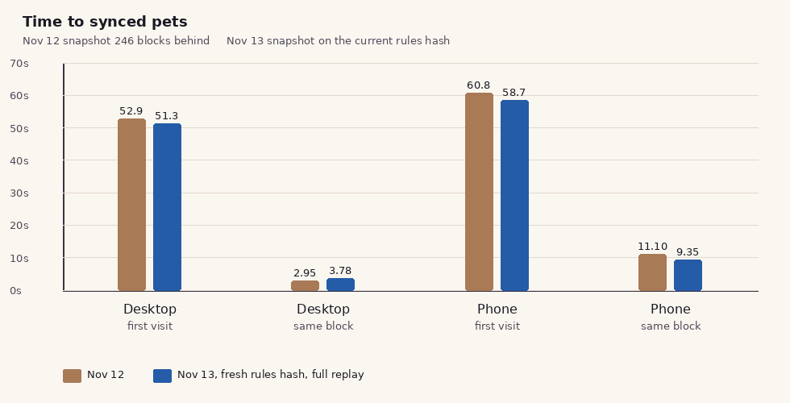

# Before timings for the sync fixes

These are the live "before" numbers for resume-from-cache, off-thread decode, and the homepage burn total. The Nov 12 column is the [PR #46](https://github.com/LongBranch13/xcpets-fun/pull/46) measurement, when the published snapshot was 246 blocks behind and on an older rules hash. The Nov 13 column is a fresh measurement of the same live site, taken 04:45–05:07 UTC on 13 Nov 2026, after the snapshot had been rebuilt.

`js/v2-rules.js` was not edited. Live and repo MD5 are both `8e98664087bab2e991680ebdb80ba143`. Nothing was merged, and the sync server was not changed.

## The two baselines, side by side

Homepage `https://xcpets.fun/`, headless Chrome 157. "Fully synced" means the chain read is verified, `updating()` is false, the boot line and the "Updating to the latest block" bar are gone, and `world()` returns a pet list.

Phone: viewport 412×915, CPU throttle 4×, Chrome DevTools Fast 4G (`latency` 165 ms, download 1,012,500 B/s, upload 168,750 B/s). Desktop: 1280×800, no throttle. A same-block return is a reload in the same profile. For two runs the median is their mean, as in PR #46. For three runs it is the middle value.

| Profile | Visit | Nov 12 wall | Nov 12 median | Nov 13 wall | Nov 13 median | Nov 12 worker | Nov 13 worker |
|---|---|---:|---:|---:|---:|---:|---:|
| Desktop | First | 54.0 s, 51.8 s | **52.9 s** | 50.5 s, 51.3 s, 52.5 s | **51.3 s** | 45.3 s | **43.5 s** |
| Desktop | Return, same block | 2.82 s, 3.08 s | **2.95 s** | 3.53 s, 4.02 s | **3.78 s** | none | **none** |
| Phone | First | 56.9 s, 64.8 s | **60.8 s** | 58.2 s, 58.7 s, 60.1 s | **58.7 s** | 44.9 s | **44.0 s** |
| Phone | Return, same block | 11.7 s, 10.6 s | **11.1 s** | 8.96 s, 9.74 s | **9.35 s** | none | **none** |

Nov 12 pets were 171,223 from 4,754 burns. Nov 13 pets moved with the chain: 172,223 (4,778 burns, tip 975,631), then 173,223 (4,780 burns), then 174,223 (4,791 burns, tip 975,635).

A fresh snapshot did not shorten the first visit. Every first visit replayed the full burn list. `V2BootSync.justSeeded` stayed false, and the browser downloaded **0** snapshot parts.

## seedExact fell back to a full replay

The snapshot that was live for this whole window:

| | |
|---|---|
| Built | 2026-11-13T04:41:43.557Z |
| Snapshot tip | 975,631 |
| Rules hash | `r16a9352e18f8366e445f7890f8148fc7` (matches the page) |
| Manifest `inSig` | `975631\|4778\|793db39f\|3448\|bfac5ee7` |
| Ops | `[]` |
| Checkpoint | present, tip 975,631, 75 parts |
| `replayMs` / `maxRss` | 118.8 s / 1.83 GB |
| Rebuild rule | every 5 min, and only when the snapshot is 6 or more blocks behind |

At 04:41 the chain tip was also 975,631, so the snapshot was 0 blocks behind. By the open-page update the chain tip was 975,635 and the snapshot was still 975,631 (4 behind). Four is inside the client's 8-block catch-up window, and under the publisher's 6-block rebuild line, so the publisher was right to leave it.

What the page did:

| Run | Page tip | Blocks behind the snapshot | Path | Parts | `justSeeded` | Worker |
|---|---:|---:|---|---:|---|---|
| Desktop cold 1 | 975,631 | 0 | full replay | 0 | false | replay, 42.7 s |
| Desktop cold 2 | 975,632 | 1 | full replay | 0 | false | replay, 44.1 s |
| Desktop cold 3 | 975,635 | 4 | full replay | 0 | false | replay, 43.5 s |
| Phone cold 1 | 975,632 | 1 | full replay | 0 | false | replay, 44.9 s |
| Phone cold 2 | 975,633 | 2 | full replay | 0 | false | replay, 44.0 s |
| Phone cold 3 | 975,635 | 4 | full replay | 0 | false | replay, 43.7 s |
| Same-block returns | unchanged | — | IndexedDB | 0 | false | none |

Each cold visit requested `/xp/v1/world/latest.json` and the manifest, then stopped. The manifest URL stayed `.../975631/manifest.json` even after the chain moved. No `root.json`, `part-*.json`, or `cp-*.json` request was sent. No seed worker and no catch-up worker were constructed.

Two checks in the live `acceptManifest` (`js/v2-boot-sync.js`, MD5 `35172e02fb07926f46d54671757fc013`, same bytes as this repo) explain the two distances:

**0 blocks behind** (desktop cold 1). Exact mode requires `behind === 0` and `man.inSig === api.inSig()`. The page's key for that visit was

`r16a9352e18f8366e445f7890f8148fc7|975631|4778|793db39f|3448|bfac5ee7|dex6cdd0303|[]`

The row hash and the block-hash hash match the manifest. The page then appends `|dex6cdd0303` because `inSigOf` in `js/v2-chain.js` adds a sale-data hash whenever `dex` is present. The manifest has no dex suffix. The strings differ, so exact mode is false. Catch-up mode requires `behind > 0`, so a snapshot that is exactly current cannot take it either. `acceptManifest` returns provisional, `seedExact` returns false, and the replay worker is posted the full burn list.

**1 to 4 blocks behind** (the other cold visits). Rules hash matches, ops are `[]`, a checkpoint exists, and the gap is within `STALE_MAX` (8), so `acceptManifest` would choose catch-up. `catchUp` calls `ruleUrls()` before it creates a worker. `ruleUrls` returns null when `buildId()` cannot read `document.currentScript`, and `seedExact` runs in a promise after `v2-boot-sync.js` has finished, so `currentScript` is null. `catchUp` rejects. `seedExact` turns that rejection into false. The measured page then starts the replay worker. That matches the network log: the manifest was fetched, and no checkpoint file was.

The 60 s poll on an open `play.html` does not call `seedExact`. It calls `refreshFull`, which is `load`, then IndexedDB, then `workerReplay`.

## Chain read

The instrumented pass (cold 3 and the matching return) recorded response sizes. The sync body is still one call, about 446 KB. Time to headers includes the round trip.

| Run | Sync bytes | Time to headers | Total | World index + manifest |
|---|---:|---:|---:|---|
| Desktop cold 3 | 446,313 | 707 ms | 1,171 ms | 2 requests, 19,828 bytes |
| Desktop return 3 | 446,216 | 915 ms | 1,288 ms | 0 (IndexedDB key matched) |
| Phone cold 3 | 446,385 | 772 ms | 1,409 ms | 2 requests, 19,828 bytes |
| Phone return 3 | 446,216 | 982 ms | 1,595 ms | 0 |

Nov 12 desktop sync was 444,277–444,300 bytes, headers at 545–670 ms, total 641–766 ms. The read is still about a second. The first visit is still the replay.

On the first matrix each cold visit also started the homepage supply walk, 6 pages of `/v2/assets/XCPETS/destructions`. Those calls are the same widget as in PR #46. They are not the pet path: the replay worker was already posted while they were in flight.

Step 3 ("Rebuilding every pet from the burns") landed at 1.33 s, 1.43 s, and 3.01 s on the three desktop first visits (median 1.43 s) and at 3.61 s, 3.62 s, and 3.35 s on the phone (median 3.61 s). Nov 12's verified medians were 1.22 s desktop and 3.27 s phone.

## Return visits and long tasks

Same-block returns used IndexedDB and did not replay.

| Return | Wall | Long tasks |
|---|---:|---|
| Desktop, tip 975,632 | 3.53 s | max 161 ms, none over 200 ms |
| Desktop, tip 975,635 | 4.02 s | 3 tasks, 494 ms total, max 224 ms |
| Phone, tip 975,633 | 8.96 s | max 596 ms, 3 over 200 ms |
| Phone, tip 975,635 | 9.74 s | 48 tasks, 4.86 s total, max 591 ms, 3 over 200 ms |

Nov 12 phone returns were 11.1 s median, with long tasks up to 711–766 ms. The 4× phone profile still spends several seconds decoding the saved world on the main thread, and it still has tasks over 200 ms. That is the number fix 3 is measured against.

One phone reload is kept with the tip-change notes. During it the tip moved from 975,632 to 975,633, the visit issued two sync reads and a manifest fetch, and the wall was 75.5 s. The final document had no worker because a tip change on the homepage stores the new world and reloads. The 9.35 s median is the two reloads whose tip stayed put.

One desktop reload crossed 975,631 → 975,632 (rows 4,778 → 4,780). It full-replayed: wall 53.5 s, worker 43.3 s, 0 parts, `justSeeded` false. The 3.78 s median is the two reloads whose tip stayed put.

Phone cold 1 (60.1 s, worker 44.9 s) ran while a local replay was using a core. The other two phone first visits, taken with that job paused, were 58.7 s and 58.2 s. The worker times stayed near 44 s on both profiles. As in PR #46, the 4× throttle does not slow the dedicated worker.

## One tip change on an open page

`play.html` was opened at tip 975,633 (4,780 burns, 173,223 pets). Boot was a full replay: worker CPU 43.7 s, ready at 51.7 s, `justSeeded` false. The snapshot was 975,631.

The page was left open. About 8 minutes later the poll saw tip **975,635** and **4,791** burns (11 new burns; 975,634 was not a separate poll). The same replay worker was posted a second time with the **full** 4,791 rows. There was no seed worker and no catch-up worker.

| When | Posted rows | Posted tip | Worker CPU | Worker wall |
|---|---:|---:|---:|---:|
| Boot | 4,780 | 975,633 | 43.7 s | ready at 51.7 s |
| 11 new burns, tip 975,635 | **4,791** | 975,635 | **45.8 s** | **49.2 s** |

Pets went from 173,223 to 174,223. One block of change (two chain blocks arriving on one poll) cost another full history replay. Nov 12 saw the same shape twice in a row, 45.9 s then 45.7 s, for 7 new burns.

The second post's key was

`r16a9352e18f8366e445f7890f8148fc7|975635|4791|463bf4c6|3452|a4a8db9a|dex6cdd0303|[]`

## What this changes in the fix list

The Nov 12 estimate for publishing a current snapshot (cold desktop about 53 s → about 20 s) assumed the client would apply it. This window had that snapshot, on the matching rules hash, at 0 blocks behind and then 1–4 behind. The client applied none of it. Cold time stayed about 51 s desktop and 59 s phone.

Fix 1 is the change that removes the 45 s replay on a tip move. Fix 3 is the change for the phone return's long tasks (max about 590 ms, about 48 tasks, about 5 s). Fix 4 is the homepage destruction walk, still 6 pages on a first visit, still off the pet path. A snapshot the client actually stores is a separate client bug from those three: exact mode rejects the current manifest because of the dex suffix, and catch-up dies in `ruleUrls()` before any part is fetched.

## After, on this branch

Same profiles, against a local copy of this branch with `?sync=https://node.xcpets.fun`. The chain and the snapshot are the live ones. `js/v2-rules.js` is still MD5 `8e98664087bab2e991680ebdb80ba143`.

Re-measured at 10:42 UTC on commit `86d0fa62`. The live snapshot was tip 975,661, rules hash `rdf88024c90a3ff2b4443f6a3252f4ecc` (this tree's hash), and the chain was 2 blocks ahead (975,663). Every first visit caught up. `justSeeded` was true. 78 checkpoint files. No full-history replay.

| Profile | Visit | Nov 12 | Nov 13 before | After (`86d0fa62`) | After path |
|---|---|---:|---:|---:|---|
| Desktop | First | 52.9 s | 51.3 s | **15.8 s** (15.80, 15.77) | catch-up, `justSeeded` true |
| Desktop | Return, same block | 2.95 s | 3.78 s | **4.49 s** (4.81, 4.18) | IndexedDB |
| Phone | First | 60.8 s | 58.7 s | **41.3 s** (41.1, 41.5) | catch-up, `justSeeded` true |
| Phone | Return, same block | 11.1 s | 9.35 s | **13.1 s** (13.0, 13.1) | IndexedDB |

Return visits in that same run: desktop **4.30 s** (4.46 s, 4.14 s) and phone **12.7 s** (12.6 s, 12.8 s). A later throttled phone return was 12.6 s. Desktop return long tasks stayed under 200 ms (max 159 and 189). Phone return still has tasks of about 600 ms.

### Where the 41.4 s phone first visit goes

A throttled phone first visit in the same conditions (412 px, 4× CPU, Fast 4G, snapshot one block behind) took **40.1 s** wall, `justSeeded` true. The catch-up worker reported:

| Piece | Time |
|---|---:|
| Checkpoint download and parse | **17.5 s** |
| Write the world to IndexedDB | 2.4 s |
| Encode the finished world | 2.0 s |
| Encode the next checkpoint | 1.9 s |
| Catch-up replay (new burns and the final pass) | 1.6 s |
| Load the rule scripts | 2.2 s |
| Decode the checkpoint | 0.5 s |
| Main thread receives the saved world and finishes boot | about 7 s |

The decompressed checkpoint is 270 MB and **16.5 MB** on the wire. Fast 4G’s download cap is 1,012,500 bytes/s, so the transfer itself cannot finish in less than about **16.3 s**. The measured 17.5 s is that floor plus a short gap from loading the rule scripts before the fetches started, and from taking files four at a time.

The catch-up worker now starts every checkpoint fetch before it imports the rule scripts, and it no longer queues them four at a time. That overlaps the script load with the transfer and keeps the pipe full. It does not shrink the 16.5 MB, so it cannot beat the 16.3 s floor. A smaller snapshot would, and that is a publisher change. The catch-up replay itself is 1.6 s, not the old 45 s full history.

The 10:42 run is `86d0fa62` with the snapshot 2 blocks behind. Pets 176,223.

### Return visits, checked again

Four reloads after one cold visit, same snapshot. `86d0fa62` only changes when the checkpoint fetch starts, which a return visit does not do.

| | Desktop returns | Phone returns |
|---|---|---|
| Baseline | 3.78 s | 9.35 s |
| `12e2a279` | 3.98, 3.98, 3.49, 4.24 s (mean 3.92 s) | 12.47, 12.33, 13.08, 12.83 s (mean 12.68 s) |
| `86d0fa62` | 5.77, 3.73, 4.68, 3.69 s (mean 4.47 s) | 13.44, 12.67, 13.64, 12.73 s (mean 13.12 s) |

`86d0fa62` is not slower than `12e2a279` in a way that repeats. The phone cluster is 12.3–13.6 s on both commits. The desktop gap is one 5.8 s sample. The phone gap versus the 9.35 s baseline is on both commits, so it is the saved-world read, not the early download. Reading that world through a worker cloned it onto the phone a second time. The page now reads IndexedDB once on the main thread. Four returns after that change (`60b1c4f1`): desktop 3.01, 3.13, 3.43, 2.65 s (mean **3.05 s**). Phone same-block returns stayed 13.40, 12.46, 12.71 s (mean **12.9 s**); one reload was a new block and is not in that mean. First visits on that same run stayed a catch-up: desktop 15.7 s, phone 41.5 s, `justSeeded` true.

### Phone return, split apart

Same phone profile (412×915, 4× CPU, Fast 4G), tip 975,667, 176,223 pets, after `60b1c4f1`. A same-block reload does not start a replay worker. `justSeeded` stays false.

| Piece | Warm 1 | Warm 2 | Warm 3 |
|---|---:|---:|---:|
| Wall | 13.24 s | 13.14 s | 14.10 s |
| IndexedDB read, 76 parts | 4.19 s | 4.80 s | 4.64 s |
| Deserialize | 1.75 s | 1.60 s | 1.61 s |
| Replay | none | none | none |
| Reindex | 0.14 s | 0.09 s | 0.09 s |

The IndexedDB read is the delivery of the records onto the main thread. Opening the database is under 60 ms. Putting every get in one transaction, with no timer between records, left that read at about 4.0 s (4.04, 4.20, 3.97 s). A second transaction per record was not the wait.

About 7 s of the 13 s sits outside those phases. On the next run the timestamps showed where: `boot()` starts only after the blocking scripts, at about 4.5–7.5 s, and the saved-world read used to start then, after the chain check and the rules hash. Decode then ran on a busy 4× thread.

`js/v2-idb-early.js` starts the IndexedDB read before `rjs/config.js` downloads. It does not create a database, and it does nothing while the page is prerendering or Save-Data is on. `boot()` still decodes during the chain check, and it drops that read when this visit stored a new snapshot. The file is not in the rules hash.

Three same-block phone returns after that change, tip 975,667:

| Piece | Warm 1 | Warm 2 | Warm 3 |
|---|---:|---:|---:|
| Wall | **8.97 s** | **8.49 s** | **9.74 s** |
| IndexedDB read | 4.04 s, finished at 5.90 s | 3.99 s, finished at 5.66 s | 3.94 s, finished at 5.62 s |
| Scripts done (`boot`) | 6.02 s | 5.74 s | 5.72 s |
| Deserialize | 2.78 s | 2.59 s | 1.77 s |
| Replay | none | none | none |
| Reindex | 72 ms | 85 ms | 73 ms |
| After reindex, until the boot line is gone | 72 ms | 56 ms | 62 ms |

Median **8.97 s** (mean 9.07 s). The 4 s read now finishes before the scripts do, so it is no longer added on top of them. What is left on the clock is the script load under Fast 4G and 4× CPU, then deserialize. Replay is still none. Long tasks are still over 200 ms (max 593, 557, and 1,359 ms).

Desktop returns on the same build, no throttle: **2.31, 2.46, 2.08 s** (median **2.31 s**), no replay worker, `justSeeded` false. The desktop first visit in that run was a catch-up, **16.7 s**, `justSeeded` true. The phone first visit in the phone run was **40.9 s**, `justSeeded` true. The checkpoint transfer is unchanged.

### Checkpoint size

`node.xcpets.fun` (Caddy, not GitHub Pages) already compresses the 78 checkpoint files. For the 975,661 snapshot: uncompressed 273.5 MB, gzip 21.5 MB, brotli **16.8 MB**. Chrome asks for brotli and gets it. A new binary encoding would have to beat brotli of the JSON and ship a new publisher format. That is not a low-risk change, and it was not built. Fast 4G at 1,012,500 bytes/s needs at least 16.5 s to move 16.8 MB.

### Exact mode, and a snapshot on a different rules hash

The signature compare accepts the live manifest when the tip, burn count, burn hash, and block-hash hash match, including when the manifest omits `|dex…` and the page has it. It refuses a dex suffix that is present and different, and it refuses a different burn hash or tip. `tools/snapshot-accept-test.js` covers those cases.

At 06:09 the publisher replaced the snapshot. The new manifest's chain signature was `975637|4791|463bf4c6|3454|b69e2e91`, the same chain components as the page plus the page's `|dex6cdd0303`. Its rules hash was `raf4e00a41637e02f188fa1123ba3e2b1`. The page's rules hash was still `r16a9352e18f8366e445f7890f8148fc7`. The page logged the refusal and did not download parts. A different rules hash is not applied.

`buildId()` is captured while `v2-boot-sync.js` is evaluating, so `ruleUrls()` still returns the replay worker after `document.currentScript` is gone. A catch-up failure is logged (`[xcpets] snapshot seed failed` or `snapshot not used`) and the page falls back to a full replay.

### Replay hashes

A snapshot two blocks behind plus the burns in the gap matches a full replay at the later tip (same world digest) in `tools/sync-phase1-test.js`. That run also checked three snap fixtures and the then-current tip 975,635: the snapshot digest matched the replay worker in Chrome, and replay output was `SAME` against `origin/main`.

Incremental resume matches a full replay by a sorted state hash, in `tools/resume-equiv-test.js`. Every snap fixture, and the shipped live list of 4,754 burns, matched at a half split, a 0.9 split, three blocks back, and a tip-only change (same burns, new tip, one extra sale credit). The live hash for the unchanged final tip was `f0023feef774`. The tip-only pair matched each other at `20f62a48c610`.

Re-run on this tree, after the early IndexedDB read: `tools/sync-phase1-test.js` **119 passed, 0 failed**, including “snapshot at tip T-2 plus catch-up matches a full replay at tip T” and `SAME` for snap-971786, snap-972883, and snap-972901. `tools/doom-week-test.js` **34 passed, 0 failed**. `tools/practice-mode-test.js` **89 passed, 0 failed**. `tools/resume-equiv-test.js` **all passed**. The shipped live list is now tip 975,637 with 4,791 burns. Half, 0.9, and three blocks back each hashed `ad786541c564`. The tip-only pair hashed `7c0de08c23e9`. `js/v2-rules.js` MD5 is still `8e98664087bab2e991680ebdb80ba143`.

## Raw runs

`design/sync-fix/before/` is the Nov 13 live baseline. `design/sync-fix/after/summary.json` is the catch-up matrix above.
