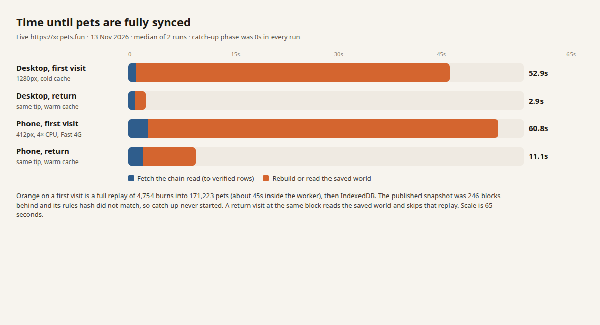

# Why updating to the latest block takes so long

The node is answering. The wait is a full rebuild of every pet on the device.

On 13 Nov 2026 the live chain reader at `https://node.xcpets.fun` was caught up (lag 0, tip 975,627, later 975,629). One sync read of every XCPETS burn is about 444 KB and finishes in about 0.7 s on desktop and 1.1 s on a Fast 4G throttle. The published pet-world snapshot is a different thing, and the page refuses it. It was built at `2026-11-11T03:07:17Z` for block **975,381**, which is **246 blocks and about 49 hours** behind the tip we measured, and its rules hash does not match the page that is live now. With the snapshot refused, every new set of inputs replays all ~4,760 burns into ~171,000 pets in a worker. That replay is about **45 seconds**. A return visit at the **same** block skips it and is done in a few seconds.

`js/v2-rules.js` was not changed. Live and repo MD5 are both `8e98664087bab2e991680ebdb80ba143`.

## Timings

Homepage `https://xcpets.fun/`, headless Chrome 157. Each cell is one run. The median of the two runs is in the last column of each pair. "Fully synced" means the chain read is verified, `updating()` is false, the boot line and the "Updating to the latest block" bar are gone, and `world()` returns a pet list.

Phone profile: viewport 412×915, CPU throttle 4×, network set to the Chrome DevTools Fast 4G values (`latency` 165 ms, download 1,012,500 B/s, upload 168,750 B/s, which DevTools uses to target 60 ms RTT and 9 Mbps / 1.5 Mbps). Desktop: 1280×800, no throttle.

| Profile | Visit | Wall to synced | Median | Chain read verified | Median | Replay worker CPU | Median |
|---|---|---:|---:|---:|---:|---:|---:|
| Desktop | First | 54.0 s, 51.8 s | **52.9 s** | 1.30 s, 1.13 s | **1.22 s** | 45.9 s, 44.7 s | **45.3 s** |
| Desktop | Return, same block | 2.82 s, 3.08 s | **2.95 s** | 0.99 s, 1.24 s | **1.11 s** | none | **none** |
| Phone | First | 56.9 s, 64.8 s | **60.8 s** | 3.20 s, 3.35 s | **3.27 s** | 41.7 s, 48.2 s | **44.9 s** |
| Phone | Return, same block | 11.7 s, 10.6 s | **11.1 s** | 3.03 s, 1.95 s | **2.49 s** | none | **none** |

Pets at the end of every matrix run: **171,223**. Burns replayed on a first visit: **4,754**. Burns replayed on a same-block return: **0** (IndexedDB key matched).

### (a) Chain read and snapshot check

The pet path uses one call, `GET /xp/v1/sync?since=0`. It did not hit the 5 s abort (`FULL_MS` in `js/v2-boot-sync.js`).

| Run | Sync bytes | Time to headers | Total |
|---|---:|---:|---:|
| Desktop cold 1 | 444,300 | 670 ms | 766 ms |
| Desktop cold 2 | 444,277 | 545 ms | 641 ms |
| Phone cold 1 | 444,277 | 486 ms | 1,084 ms |
| Phone cold 2 | 444,277 | 588 ms | 1,127 ms |

Time to headers includes one round trip, so it is the wait before the body, not a pure server-CPU number. The body is the rest of the total. The sync endpoint is a small part of the 53–61 s first visit.

The page also requested the snapshot index and then stopped:

| | Count | Bytes |
|---|---:|---:|
| `/xp/v1/world/latest.json` + `manifest.json` | 2 | ~17 KB |
| Snapshot parts (`root.json`, `part-*.json`) | **0** | 0 |
| Catch-up worker | **0** | — |

A separate homepage widget (`js/token-box.js`) walks every burn page on `node.xcpets.fun/v2` to sum supply. That is 5 destruction pages plus `/`, the asset, and the mempool: **9** `/v2` calls, about **1.46 MB**, on each first visit. The slowest pages spent **3.4–7.6 s** waiting for headers and then transferred ~300 KB. Those calls are not on the pet path. The replay worker was already posted, with all 4,754 rows, at about 1.6 s, while those pages were still in flight.

The unused snapshot, measured with `Accept-Encoding: br` outside the browser, is **14.3 MB** on the wire (66 parts + root) and **249 MB** uncompressed. The catch-up checkpoint is **14.4 MB** brotli.

### (b) Catch-up since the snapshot

Catch-up did not run in any of the eight runs.

The manifest said the snapshot could have covered the gap:

| | |
|---|---|
| Snapshot tip | 975,381 |
| Page tip during the matrix | 975,627 |
| Blocks behind | **246** (the client allows 8) |
| Burns after the snapshot | **486**, in 75 of those blocks |
| Rules hash on the page | `r16a9352e18f8366e445f7890f8148fc7` |
| Rules hash on the snapshot | `r8e8a9379837c36d6ab8404ffd2824965` |

Either mismatch is enough for `acceptManifest` to refuse the world. Both were true.

### (c) "Rebuilding every pet" (step 3)

On a first visit the boot line switches to "Rebuilding every pet from the burns… (step 3 of 3)" when the sync read is verified (~1.2 s desktop), then to "Building every pet from 4,754 XCPETS burns…". The worker then runs `V2Rules.replay` on **all 4,754 rows**.

| | Desktop cold | Phone cold |
|---|---|---|
| Worker CPU (`ms` posted by the worker) | 45.9 s, 44.7 s | 41.7 s, 48.2 s |
| Worker wall, including the IndexedDB write | 49.8 s, 48.0 s | 45.3 s, 52.1 s |
| Main-thread long tasks during that worker | 1 task, ~80 ms | 3 tasks, ~0.4 s |
| Main-thread long tasks while the saved world is read back | 4–5 tasks, ~0.6 s, max 221 ms | 45–46 tasks, ~5.2 s, max 828–840 ms |

The 45 s rebuild is off the main thread. The main thread's long tasks are the IndexedDB decode after the worker stores the world (74 parts, 294,463 table entries on these runs).

On a same-block return the step 3 line still appears, and no replay worker starts. The time is the sync read plus decoding the saved world: about **1.8 s** of that on desktop (4–5 long tasks, max 176 ms) and about **8.6 s** on the throttled phone (about 48 long tasks, max 711–766 ms).

The 4× CPU throttle slowed that main-thread decode by about 4×. It did **not** slow the worker: worker CPU stayed ~45 s on both profiles. A real phone with a slower core would stretch the 45 s as well. This phone profile shows the main-thread cost, and the worker cost of this machine.

## One new block on an open page

`play.html` polls `V2Mock.refresh` every 60 s. It was opened, synced at tip 975,627 (boot replay 42.2 s of worker CPU, 4,754 rows, 171,223 pets), and left open. For about 15 minutes the tip stayed put and no second replay started.

Then the burn list grew by **7** rows (4,754 → 4,761) and, on the next poll, the tip moved **975,627 → 975,628** and the sale-data hash changed. The same replay worker was posted twice more. Both posts carried the **full** row list. There was no catch-up worker and no snapshot download. The "Updating to the latest block" bar did not appear; that bar is the boot path. Burns still wait while `updating()` is true.

| When | Posted rows | Posted tip | Worker CPU | Worker wall |
|---|---:|---:|---:|---:|
| Boot | 4,754 | 975,627 | 42.2 s | 45.6 s |
| 7 new burns, tip not moved yet | **4,761** | 975,627 | **45.9 s** | 49.7 s |
| Tip 975,628, same 4,761 burns, new sale hash | **4,761** | 975,628 | **45.7 s** | 49.1 s |

One block of change cost two full history replays, about **92 s** of worker time, for 7 new burns. Pets went from 171,223 to 172,223. The snapshot tip was still 975,381. By 04:13 UTC the chain tip was 975,629 and the snapshot was 248 blocks behind.

## Snapshot age

Read from `https://node.xcpets.fun/xp/v1/health` and `.../world/latest.json` at 03:40 UTC, and again at 04:13 UTC.

| | 03:40 UTC | 04:13 UTC |
|---|---|---|
| Chain tip | 975,627 | 975,629 |
| Reader lag | 0 | 1 |
| Snapshot tip | 975,381 | 975,381 |
| Snapshot built | 2026-11-11T03:07:17Z | same |
| Age | ~48 h 33 min | ~49 h 6 min |
| Blocks behind | 246 | 248 |
| Manifest `replayMs` / `maxRss` | 99.2 s / 2.46 GB | same |
| Manifest site build | `0b7ff4cbf6` | same |
| Live page build | `e6db15afb2` | same |

The chain follow is current. The world publisher has not emitted a snapshot since 11 Nov. The repo default `XP_SNAPSHOT_HEAP` is 1536 MB and the last successful build peaked at 2.46 GB. This run did not read the server logs and did not change the process, so the heap cap is a lead for the ops owner, not a confirmed crash.

## What the code does

Boot on xcpets.fun calls `V2BootSync.bootFirst`, which asks for `/xp/v1/sync` and then `seedExact`.

`seedExact` downloads the world only when `acceptManifest` says the snapshot is usable (`js/v2-boot-sync.js`):

- rules hash must equal the page's hash of the replay scripts
- ops must be empty
- the snapshot is exact, or it is at most `STALE_MAX` (8) blocks behind and has a checkpoint (`js/v2-resume.js`)

The live manifest fails the rules hash and is 246 blocks behind, so `seedExact` returns without downloading parts. `bootShow` then starts `workerReplay`.

`js/v2-replay-worker.js` calls `V2Rules.replay(rows, hashes, ops, { tip, dex })` with **no** `_resume`. That function walks every burn from the v2 cutoff, then `w.pets.forEach(finish)` over every pet. The catch-up worker is the one that passes `_resume`, and only for a snapshot inside the 8-block window.

The saved world is reused only when the IndexedDB key matches. The key is the rules hash, plus `inSig()` (tip, row count, row hash, block-hash set, sale-data hash), plus local ops (`js/v2-chain.js`). A same-block reload hits it. A new burn, a new tip, or a new sale hash misses it.

On an open `play.html`, the 60 s poll calls `refresh`. A new tip calls `refreshFull`, which is `load(true).then(fromIdb).then(workerReplay)`. That is another full replay, which is what the three worker posts above recorded.

The replay worker writes the world, and the page reads it back on the main thread in 12 ms slices for the pointer fix. Delivering each IndexedDB record is still one task, which is where the 700 ms tasks on the throttled phone come from.

## Fixes, by impact

None of these edit `js/v2-rules.js`. Replay output has to stay the same. The catch-up patch already evals a copy of the rules in the worker (`js/v2-resume.js`); the file on disk stays byte-for-byte.

### 1. Resume from the cached world when the tip or the burn list moves

Client: `js/v2-chain.js` (`refreshFull` and the boot miss path), `js/v2-replay-worker.js` (store the resume meta next to the world), `js/v2-catchup-worker.js` / `js/v2-resume.js` (the patched replay that already exists).

Today, 7 new burns cost 45.9 s of worker CPU because all 4,761 rows were replayed, and the following tip/sale update cost another 45.7 s. A resume would apply those 7 burns and still run the final pass over every pet (`finish` is a few fields per pet) and still rewrite IndexedDB (about 4 s inside the worker, then ~2.5 s to read it back on desktop, ~8 s on the throttled phone).

Estimated save: about **35–40 s per update** on this machine, and about **70–80 s** on a block that arrives as two polls the way 975,628 did. A real slower phone would save a similar share of its own replay, which may be longer than 45 s.

This is the fix for an open page and for a return visit whose saved block is behind. Effort is the resume meta plus a same-output check (the snapshot-plus-catch-up compare in `tools/sync-phase1-test.js` is the pattern).

### 2. Publish a snapshot for the current rules hash, and keep it within 8 blocks

Ops / VPS / HatchBot. The builder in `tools/sync-server` already does this when it is running and the published snapshot is at least `XP_SNAPSHOT_EVERY` blocks behind (default 6). The live process has not published since 11 Nov, while the chain reader on the same host is current.

A snapshot whose rules hash is `r16a9352…` and whose tip is within 8 blocks would take the boot path that already exists: download the checkpoint (~14 MB brotli, four files at a time) and catch up the gap instead of the 45 s replay.

Estimated boot time if that path ran: download on the order of 8–15 s desktop and 15–20 s on this Fast 4G, plus a short catch-up and the IndexedDB write and decode. Cold desktop **53 s → about 20 s** (save ~30 s). Cold phone **61 s → about 30 s** (save ~30 s). These are estimates; the browser never downloaded the parts, because the manifest was refused.

This does not change the 60 s poll. An open page still full-replays until fix 1.

Do not ship a snapshot for the old hash `r8e8a937…`. The page will keep refusing it. Raising `STALE_MAX` above 8 without a matching rules hash also does nothing, and a 246-block resume from a two-day-old rules hash would be the wrong world.

### 3. Decode the saved world off the main thread

Client: the IndexedDB read in `js/v2-chain.js`. Same world, same key.

Same-block return is already 2.9 s on desktop. On the throttled phone it is 11.1 s, and about 8.6 s of that is the decode, with long tasks up to 766 ms. Moving that decode off the main thread, or making each record smaller, saves about **6 s** on that phone profile and removes those long tasks. It does not remove the 45 s replay.

### 4. Stop the homepage supply widget from re-reading every burn

Client: `js/token-box.js`. It pages `GET /v2/assets/XCPETS/destructions` only to sum a display total. The sync answer already has the burn list. Dropping the extra walk removes the 3–8 s `/v2` calls and about 1.5 MB. It does not shorten the pet rebuild. The head prefetch of the first burn page, `/`, and the mempool can stay; it is three small calls and the pet path no longer waits on them once sync succeeds.

### 5. A smaller snapshot

Worth doing only after fix 2 is actually used. The transfer size is already 14.3 MB brotli against 249 MB raw. Cutting it further saves a few seconds of download, not the 45 s replay.

### Already in place

- The replay runs in `js/v2-replay-worker.js`, not on the main thread, unless the worker errors.
- The burn list, hashes, mempool, and sale data for the pet world arrive in one `/xp/v1/sync` response.
- A same-block return reads the IndexedDB world and does not replay.

## What was not touched

No game code was changed. No Recover, Reset, sign, or broadcast. The sync server, its timer, and the VPS were not modified. Raw runs, the block-watch log, and this note are under `design/sync-perf/`.
